# Wazuh SIEM & Automated Incident Response Project

## Executive Summary
This project demonstrates the end-to-end architecture, deployment, and configuration of an automated Security Operations Center (SOC). Using Wazuh as the core SIEM, the objective was to move beyond passive log aggregation by engineering custom detection logic mapped to the MITRE ATT&CK framework and automating kernel-level threat mitigation (IPS) to achieve a zero-minute Mean Time to Respond (MTTR).

## Architecture & Technology Stack
* **SIEM Core:** Wazuh Manager, Indexer, and Dashboard (Containerized via Docker on Ubuntu).
* **Victim Endpoint:** Ubuntu Linux Host OS (Native Wazuh Agent, OpenSSH Server).
* **Threat Actor Node:** Parrot Security OS.
* **Tooling:** Python (Exploit Emulation), XML (Decoder/Rule Engineering), Linux `iptables`.

---

## Phase 1: Infrastructure & Log Aggregation

The SIEM infrastructure was deployed via Docker Compose to ensure component isolation and resource efficiency, with host virtual memory tuned to support the Elasticsearch backend. The Wazuh Agent was installed natively on the Ubuntu host OS to aggregate authentication logs and system metrics, routing telemetry back to the containerized manager via a local Docker bridge.

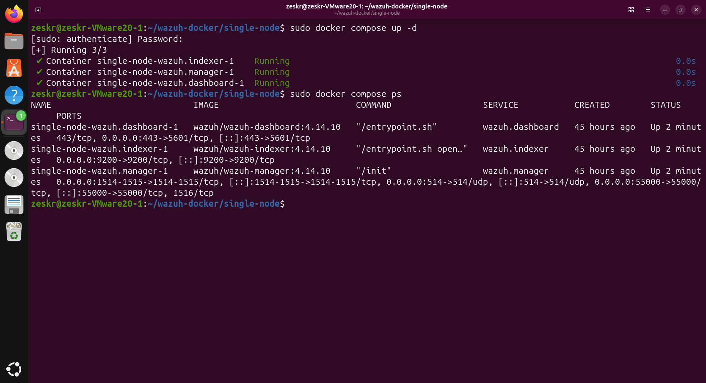
*Fig 1: Containerized SIEM stack deployment and runtime validation.*

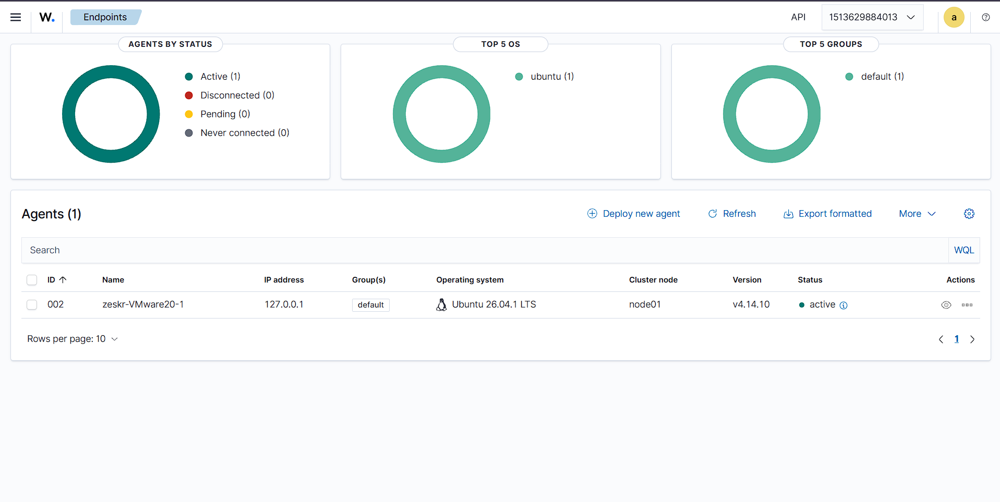
*Fig 2: Cryptographic key exchange and active telemetry flow established between the Ubuntu endpoint and the Wazuh Manager.*

---

## Phase 2: Red Team Threat Emulation

To validate the SIEM's ingestion and parsing capabilities, targeted adversary behavior was emulated. A custom Python script (`mitre_t1110.py`) was developed utilizing the `paramiko` library to execute an asynchronous SSH brute-force attack from the Parrot OS node against the Ubuntu endpoint.

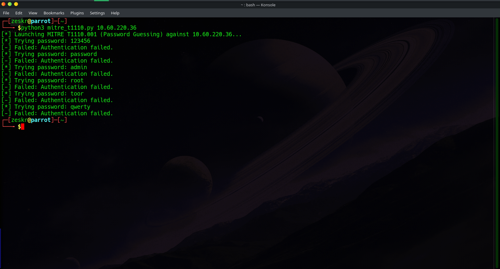
*Fig 3: Execution of the custom brute-force exploit script from the attacker node.*

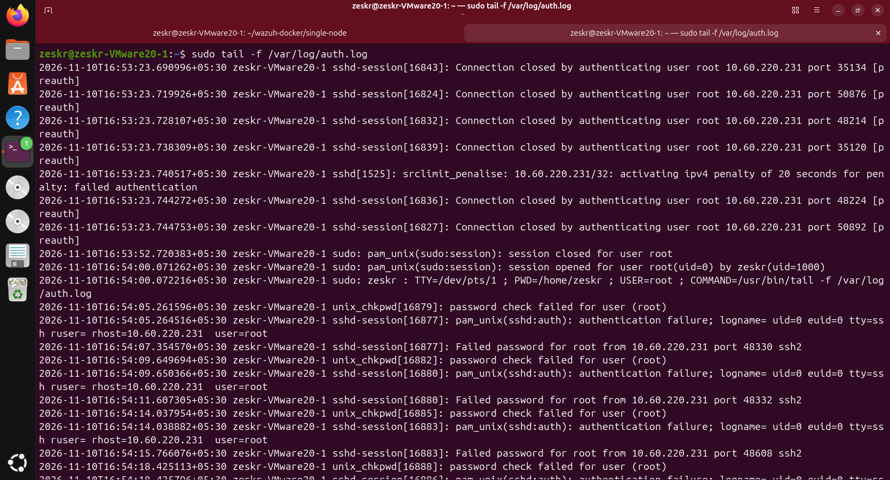
*Fig 4: Verification of raw OS-level telemetry generation (`/var/log/auth.log`) prior to SIEM ingestion.*

---

## Phase 3: Detection Engineering (Blue Team)

Wazuh natively parses SSH authentication failures under Rule `5760` (Level 5). Relying on default rules for authentication failures generates severe alert fatigue in production environments. 

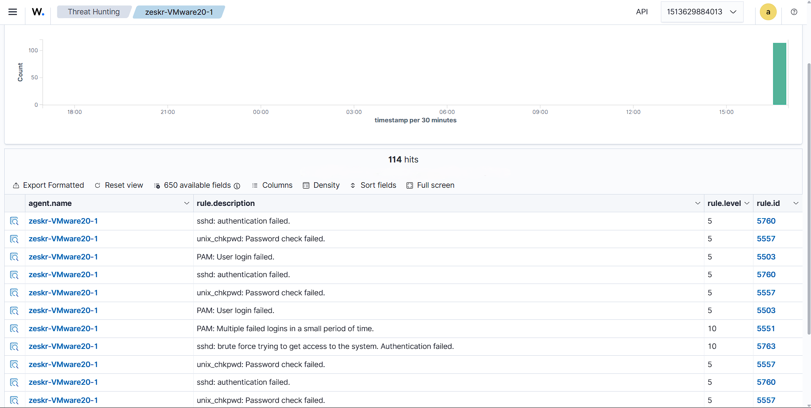
*Fig 5: Baseline SIEM ingestion showing standard, unoptimized Level 5 alerts.*

To address this, custom XML detection logic was engineered within `local_rules.xml`. A stateful threshold was implemented: if four consecutive `5760` events occur within a 60-second rolling window from a single source IP, the event is elevated to a Critical Level 12 alert and explicitly tagged with **MITRE ATT&CK T1110.001**.

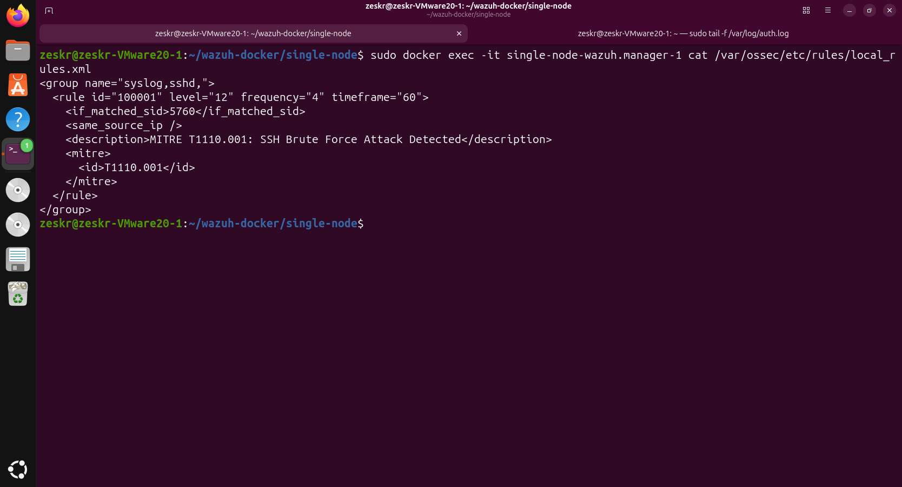
*Fig 6: Custom XML detection logic injecting stateful thresholding and MITRE mapping.*

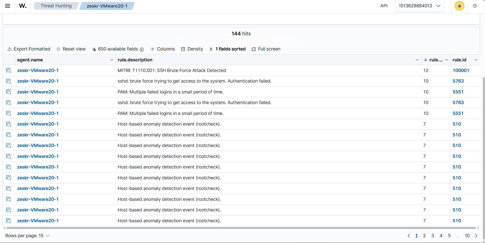
*Fig 7: Wazuh Dashboard parsing and triggering the custom Level 12 MITRE-mapped alert.*

---

## Phase 4: Automated Incident Response (Purple Team)

The final phase transitioned the environment from a passive monitoring system to an active Intrusion Prevention System (IPS). Wazuh's Active Response module was configured in `ossec.conf` to autonomously execute a `firewall-drop` script specifically bound to the custom Rule `100001`. 

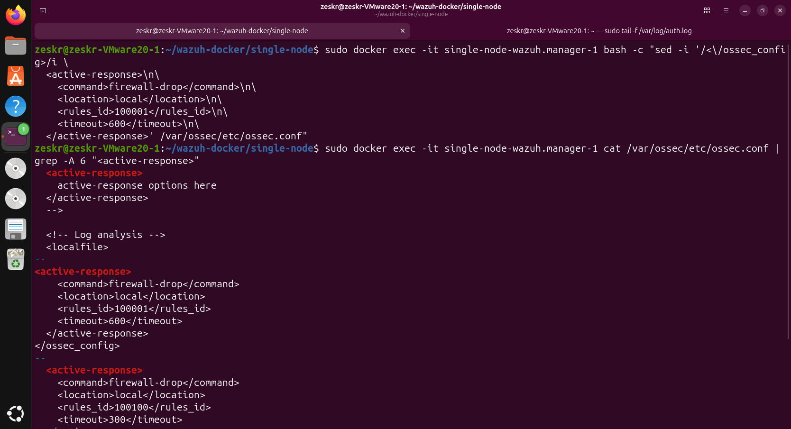
*Fig 8: Manager configuration dictating the automated response parameters and 600-second penalty window.*

Upon execution of the threat emulation script, the SIEM detected the threshold breach and immediately triggered the Active Response, terminating the attacker's network socket mid-attack.

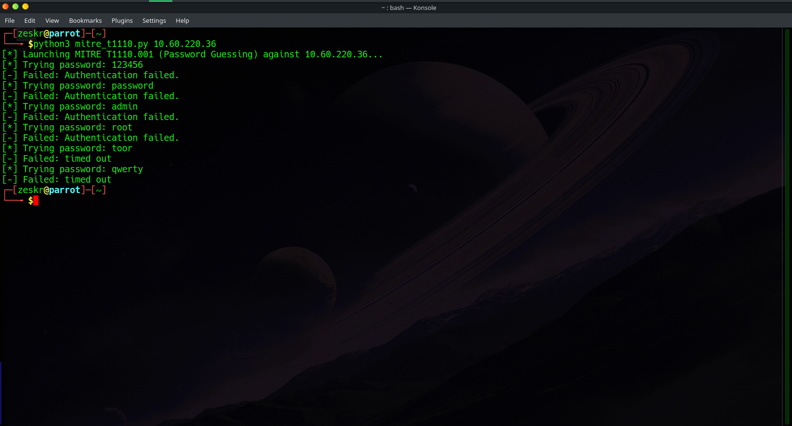
*Fig 9: Attacker POV — The Python emulation script hanging and timing out as the SIEM autonomously severs the connection.*

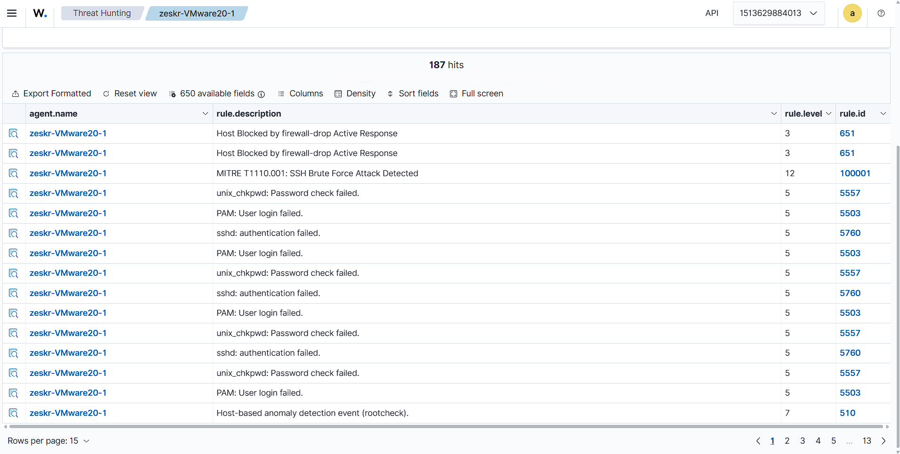
*Fig 10: Defender POV — SIEM audit logs confirming the successful execution of the active mitigation script.*

To mathematically verify the efficacy of the automated defense, the Ubuntu host's kernel routing table was audited.

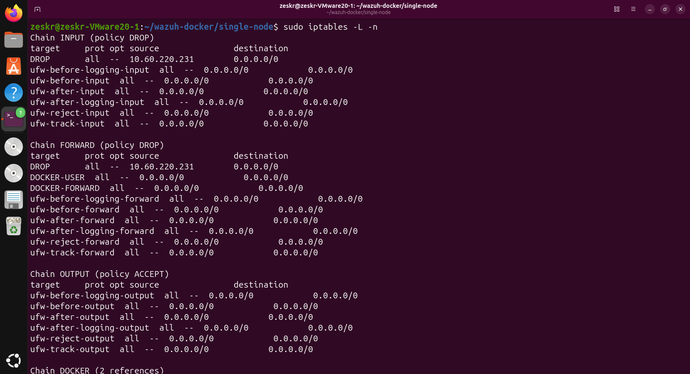
*Fig 11: OS-level verification showing the SIEM dynamically injected a strict `DROP` policy into the `iptables` INPUT and FORWARD chains for the attacker's specific IP address.*
